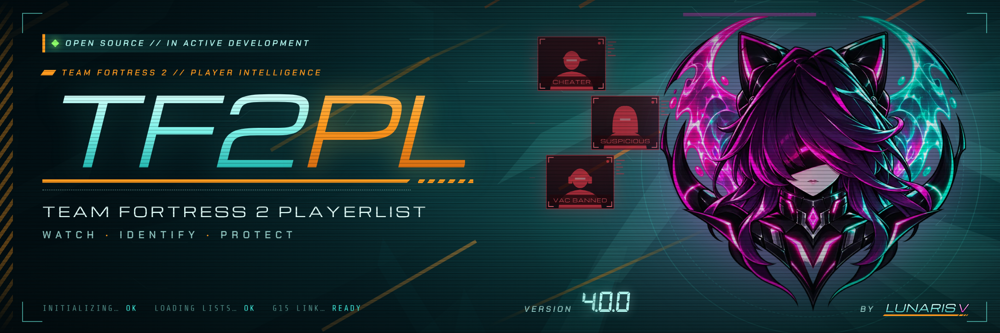
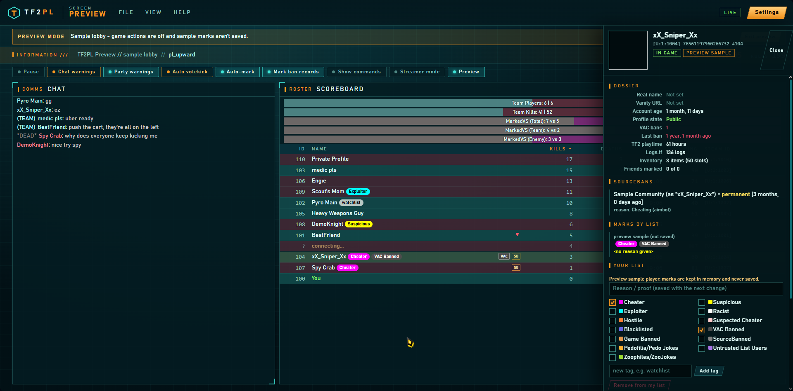
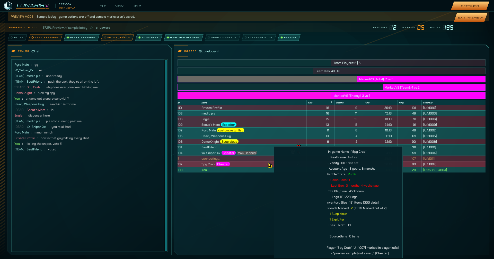
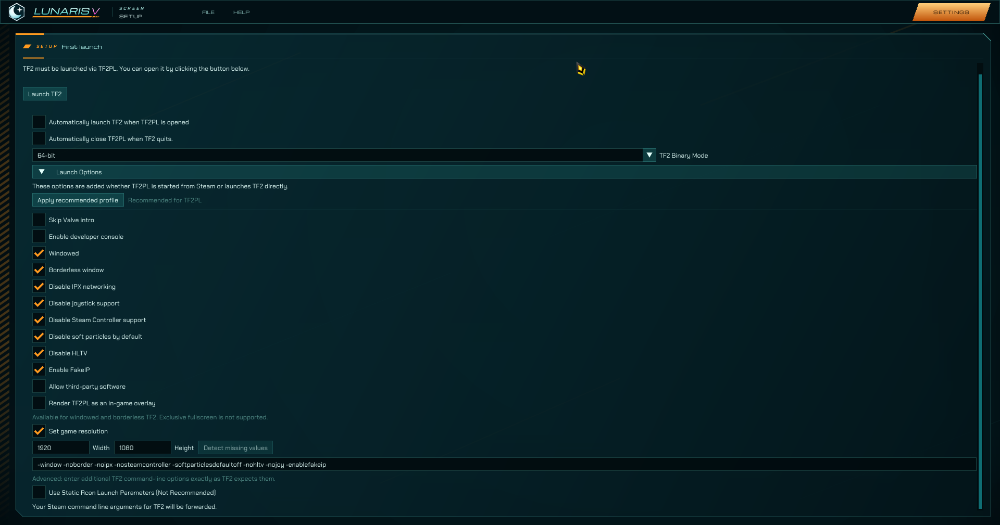
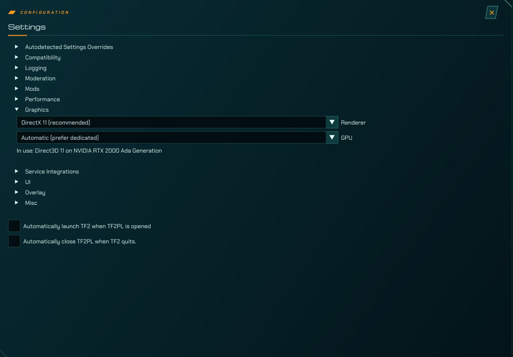
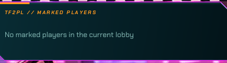
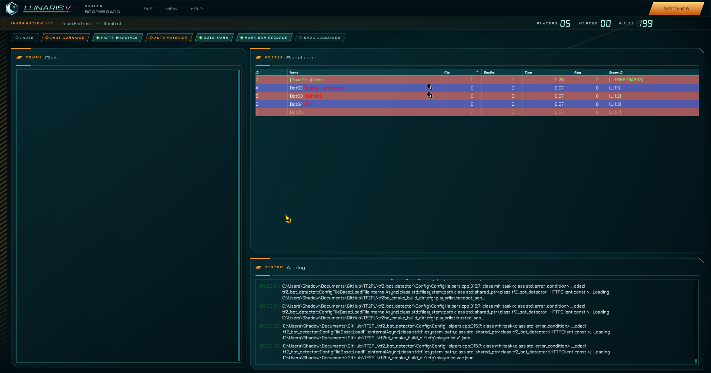
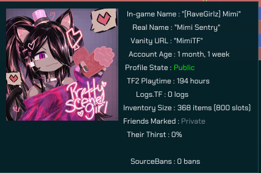
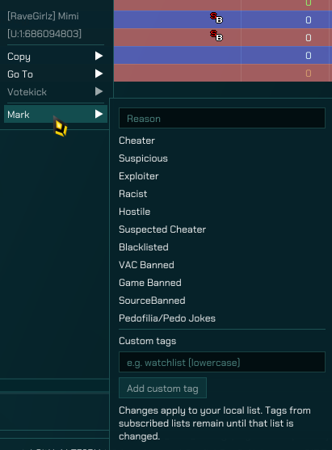

  

  <strong>A player intelligence, marking, and launch companion for Team Fortress 2.</strong> 
  TF2PL is developed by LunarisV and built on the open-source TF2 Bot Detector foundation.

  <a href="https://github.com/Lunaris-Surf/TF2PL/releases">Releases</a> ·
  <a href="https://github.com/Lunaris-Surf/TF2PL/actions">Development builds</a> ·
  <a href="https://github.com/Lunaris-Surf/TF2PL/issues">Issues</a> ·
  <a href="LUNARISV.md">Configuration guide</a> ·
  <a href="LICENSE">MIT License</a>

## What is TF2PL?

TF2PL — **Team Fortress 2 PlayerList** — keeps useful player context close while you play. It reads TF2's console output, enriches player records with supported public data, displays an at-a-glance dossier, and lets you maintain local or subscribed player lists with clear, color-coded marks.

Version 2.0 expanded the project into a single place to launch TF2, inspect a server, mark players, manage lists, and export data for compatible tools. Version 3.0 rebuilds the interface in the LunarisV style, adds a DirectX 11 renderer with GPU selection, reads players through TF2's G15 interface, and cuts the overhead TF2PL adds while you play. Version 4.0 rebuilds the foundations — a new networking stack and fmt 12 — and adds an optional browser-based interface and a full player-list manager. See the [4.0.0 release notes](docs/releases/v4.0.0.md).

> [!IMPORTANT]
> TF2PL assists human moderation. A mark is context, not proof by itself. Review evidence and follow the rules of the server or community you are playing on.

## Project scope and AI assistance

TF2PL makes use of AI-assisted tools during development, and we want to be transparent about where and why they are used:

- The maintainer is not an artist, so AI assistance may be used for project artwork and presentation. Community-created artwork is welcome; users who would like to contribute art for the README are encouraged to do so.
- Features are outlined, reviewed, tested, and debugged by real people. AI may help fill in or iterate on implementation, but it does not replace human direction or judgment.
- TF2PL is a hobby project made for fun. It is not intended to target, harass, or encourage harassment of other users.

TF2PL is **not intended to replace TF2 Bot Detector**. It is a personal, expanded version built on TF2BD that we use for our own preferred workflow and additional features.

> [!CAUTION]
> TF2PL follows a bleeding-edge development model. New releases may contain bugs or incomplete behavior. Please report reproducible issues through the repository's issue tracker.

## Highlights

- **TF2 launcher:** start the game through TF2PL with readable controls for common launch options. The recommended profile includes borderless windowed mode, disabled legacy input features, FakeIP, and display-resolution detection. Explicit width and height values are never overwritten.
- **Live player dossiers:** hover a player to see identity, account age, TF2 playtime, inventory information, activity, and available ban data.
- **Flexible player marking:** use built-in marks such as Cheater, Suspicious, Exploiter, Racist, Hostile, Zoophiles/ZooJokes, Untrusted List Users, VAC Banned, Game Banned, Source Banned, and more, plus your own custom tags.
- **Player-list manager:** browse, search and filter every loaded list, add players by SteamID, and edit marks and reasons on your local list without editing JSON.
- **Marked Friends:** see exactly which of a player's friends are marked, and in which lists.
- **Native or web interface:** use the native window, or switch to a browser UI served only on your own machine (`127.0.0.1`). The in-game overlay is available in native mode.
- **Custom tag colors:** every built-in and custom tag can have its own scoreboard color.
- **Complete Steam identity sets:** records retain SteamID, SteamID3/SteamID32, and SteamID64, with SteamID64 as the primary identity.
- **Two-format total export:** export a full TF2PL list and a TF2BD-compatible list. Marks unsupported by TF2BD are preserved in the proof field.
- **Local-first lists:** your local data remains under your control, while optional subscribed lists can add shared context.
- **LunarisV interface:** a HUD-style interface matching [lunaris.surf](https://lunaris-surf.github.io/TF2PL/), with an opaque in-game overlay. Its visual styling is inspired by **CyberiaStyle LAST APPROACH**.
- **DirectX 11 with GPU selection:** renders on your dedicated GPU by default; pick a GPU on first run or in Settings > Graphics. OpenGL remains available as a fallback.
- **G15 player data:** player names, SteamIDs, teams, ping and health come from TF2's `g15_dumpplayer` in a single reply, with `status` used only when someone joins. This works on community servers and prints far less to the console.
- **Low overhead:** TF2PL idles when it isn't focused and paces frames instead of competing with TF2 for the GPU.
- **Untrusted and blacklisted list protection:** unsupported player lists are removed automatically and lists carrying their entries are flagged; malicious (blacklisted) lists are removed and lists carrying their entries are disabled.

## Compatibility and safety notice

> [!WARNING]
> **Vorobey's HackerPolice and ShadeFall are blacklisted by TF2PL.** Both list maintainers were found to be malicious: Vorobey's HackerPolice intentionally accepts fake and manipulated evidence, and ShadeFall is run by an active cheater who uses manipulated data and marks players with fake evidence produced by its "anticheat". TF2PL deletes these lists, disables any list that carries their entries, and always warns about them.
>
> **Sterling and Shitlist are not supported by TF2PL.** The project considers these lists untrusted because they accept manipulated replays and false evidence and publish fake cheater listings. TF2PL removes these lists automatically and flags lists that carry their entries.

## Preview

### WebUI

  

The browser interface brings the scoreboard, chat, player dossiers, and marking controls together on your own machine.

### Native UI

  

The native window provides the same player intelligence alongside the in-game overlay. Both screenshots use Preview Mode's sample lobby.

### Game launcher

  

### Settings

  

### Overlay

  

### In game

  

### Player dossier

  

Hover a player in the live scoreboard to open a compact dossier. Data appears as it becomes available, so TF2PL stays useful even when an external service is unavailable or a Steam profile is private.

### Markings GUI

  

Right-click a player to copy identifiers, visit supported profile services, initiate an eligible votekick, or update your local player list. Built-in marks cover common cases; custom lowercase tags let you build a system that fits your own community.

`Racist` is reserved for racial hatred. `Hostile` covers hateful behavior directed at other protected groups, including anti-LGBT harassment. This separation keeps rules and exports explicit.

## Installation

TF2PL 4.0 and later require Windows 10 or newer on Windows.

1. Download the appropriate package from [GitHub Releases](https://github.com/Lunaris-Surf/TF2PL/releases).
2. Extract the complete package to a writable folder. Do not run the executable from inside the archive.
3. Open `TF2PL.exe` (Windows) or `TF2PL-x86_64.AppImage` (Linux) and complete the first-run setup.
4. Allow Steam integration and internet features only if you want to use them.
5. Launch TF2 from TF2PL when prompted.

TF2PL adds the launch options it needs when it starts TF2. If you start TF2 yourself instead, include `-condebug -conclearlog -usercon -g15`; without `-g15` TF2PL falls back to slower `status` polling.

Keep the packaged `cfg`, `fonts`, `images`, `licenses`, and `schemas` folders beside the executable. Missing packaged resources can prevent parts of the interface from loading correctly.

## Player-list compatibility

TF2PL continues to read TF2BD schema-v3 player lists and rules. Its extended format adds custom tags and complete Steam identity sets while keeping the familiar `players`, `steamid`, `attributes`, and `proof` structure.

Total Export writes:

- `cfg/playerlist.export.tf2pl.json` — the complete TF2PL representation.
- `cfg/playerlist.export.tf2bd.json` — limited to Cheater, Racist, Exploiter, and Suspicious attributes, with the complete TF2PL mark set recorded in `proof`.

See [LUNARISV.md](LUNARISV.md) for schema details, tag IDs, rule examples, and validation notes.

## Versioning and releases

The repository root [`VERSION`](VERSION) file is the single source of truth for the public release version. It contains a three-part semantic version such as `4.0.0`.

For the absolute earliest builds, visit [GitHub Actions](https://github.com/Lunaris-Surf/TF2PL/actions) and download an artifact from a successful workflow run. These builds contain the newest changes but receive less testing and may be unstable. [GitHub Releases](https://github.com/Lunaris-Surf/TF2PL/releases) are reserved for comparatively stable builds intended for general use.

- Change `VERSION` when preparing a release.
- CMake reads its major, minor, and patch values automatically.
- GitHub Actions appends its run number as the fourth build component.
- Release tags should use the matching `vMAJOR.MINOR.PATCH` form, such as `v4.0.0`.
- The in-app updater checks releases from this repository.

This keeps local builds, Windows resources, CI artifacts, and the updater aligned without copying a version number through several files.

## Building from source

TF2PL uses CMake, C++20, and the dependencies pinned in this repository's submodules and vcpkg manifest. Clone recursively, configure with your supported toolchain, then build the `tf2_bot_detector` target. The GitHub Actions workflows contain the maintained Windows and Linux CI configurations.

Local development builds identify themselves as custom builds. CI builds receive the workflow run number so packaged versions remain ordered for update comparisons.

## Privacy and network access

TF2PL can operate with network features disabled. When enabled, it may contact Steam services, configured player-list sources, SteamHistory-supported services, and GitHub Releases for updates. API keys are stored in the local configuration and should never be committed or shared in logs.

## Credits

TF2PL is maintained by **LunarisV**. It is derived from [TF2 Bot Detector](https://github.com/PazerOP/tf2_bot_detector), originally created by Matt “pazer” Haynie, and retains contributions and third-party attributions from that project. Full dependency license texts are shipped in the `staging/licenses` directory.

TF2PL is an independent community project and is not affiliated with or endorsed by Valve Corporation.

## License

TF2PL is distributed under the [MIT License](LICENSE).
